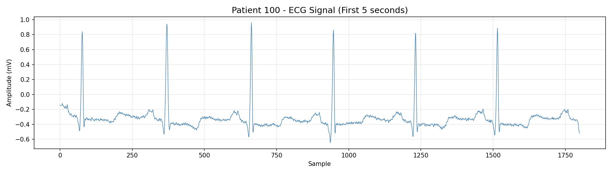
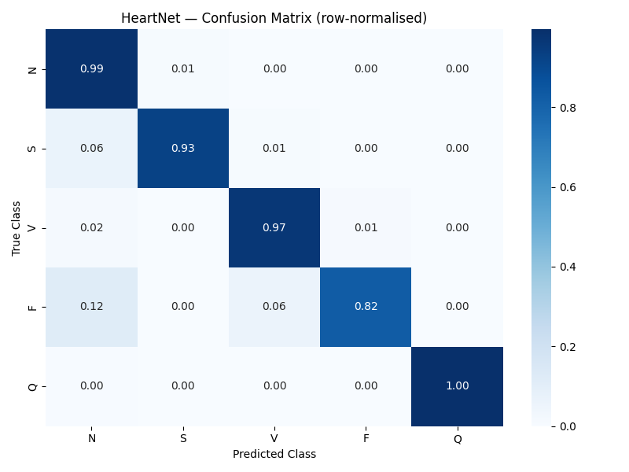
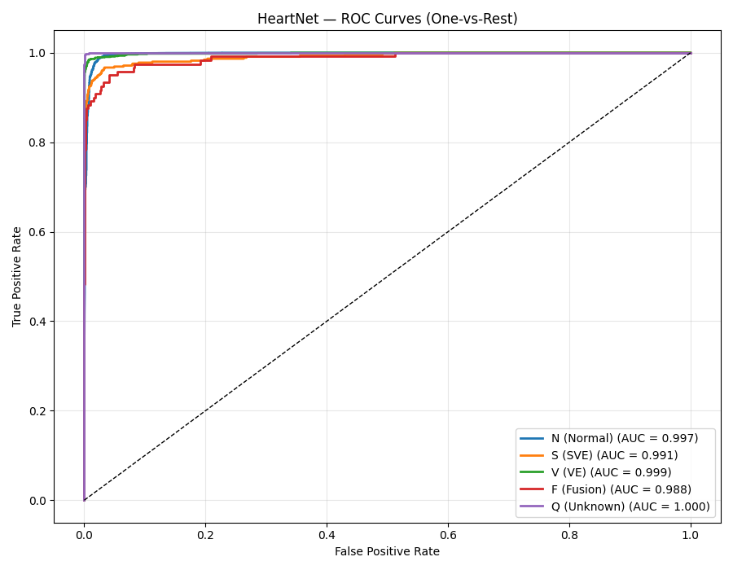

# A Comparative Study of CNN, Attention-Based CNN-LSTM, and Transformer Models for ECG Heartbeat Classification

Classifying ECG heartbeats from the MIT-BIH Arrhythmia Database into the five AAMI classes, using three deep learning architectures trained and evaluated under identical conditions.

**Author:** Poonam Sharma
**Context:** Deep Learning & Artificial Intelligence course project
**Built with:** PyTorch, scikit-learn, imbalanced-learn, WFDB



## Overview

Each heartbeat is a 180 sample window (500 ms at 360 Hz) centered on its R-peak, labeled with one of the five classes defined by the ANSI/AAMI EC57 standard:

| Class | Meaning | Beats in dataset |
|-------|---------|------------------|
| N | Normal and bundle branch block beats | 90,363 |
| S | Supraventricular ectopic beats | 3,026 |
| V | Ventricular ectopic beats | 7,235 |
| F | Fusion beats | 802 |
| Q | Paced and unclassifiable beats | 8,042 |

The data is heavily imbalanced, with more than 100 normal beats for every fusion beat, so the project focuses on macro F1 rather than accuracy alone.

Three architectures are compared:

| Model | Architecture | Parameters |
|-------|-------------|-----------:|
| Plain CNN | 3 convolutional blocks and a fully connected classifier (baseline) | 758,085 |
| HeartNet | CNN feature extractor, 2 layer LSTM, additive attention, classifier | 250,821 |
| Transformer | 1x1 convolution embedding, sinusoidal positional encoding, 3 encoder layers, global average pooling | 152,325 |

## Results

Evaluated on a held out, stratified test set (15% of beats, no oversampling):

| Model | Accuracy | Macro F1 | Precision | Recall | AUC-ROC |
|-------|---------:|---------:|----------:|-------:|--------:|
| Plain CNN | 0.9840 | 0.9104 | 0.8960 | 0.9262 | 0.9960 |
| HeartNet | 0.9820 | **0.9113** | 0.8876 | 0.9396 | 0.9951 |
| Transformer | 0.9443 | 0.7866 | 0.7264 | 0.9431 | 0.9926 |

**Key findings**

HeartNet matched the plain CNN on macro F1 with about a third of the parameters, and had higher recall on minority classes. Fusion beats were the hardest class for every model (HeartNet recall 0.82), mostly confused with normal beats, which makes sense since a fusion beat is partly a normal beat by definition. The Transformer had high recall but much lower precision, meaning it over predicted the rare classes, and it took several hours to train on CPU compared to minutes for the other two.

| HeartNet confusion matrix | HeartNet ROC curves |
|---|---|
|  |  |

Confusion matrices, ROC curves, and training curves for all models are in [`results/`](results/).

## Limitations

The train, validation, and test splits are made at the **beat level**, so beats from the same patient can appear in both training and test data. Because a person's heartbeats closely resemble each other, this intra patient setup is known to produce optimistic results on MIT-BIH. A stricter inter patient evaluation, such as the DS1/DS2 record split proposed by de Chazal et al. (2004), would better reflect performance on unseen patients and is the planned next step.

## Project Structure

```
ecg-arrhythmia-classification/
├── main.py                 # entry point, runs the full pipeline
├── preprocess.py           # beat segmentation, AAMI mapping, splits, scaling, SMOTE
├── train.py                # training loop, early stopping, LR scheduling
├── evaluate.py             # metrics, confusion matrices, ROC curves
├── download_data.py        # downloads MIT-BIH from PhysioNet
├── requirements.txt
├── models/
│   ├── cnn.py              # Plain CNN baseline
│   ├── heartnet.py         # CNN + LSTM + attention
│   ├── transformer.py      # Transformer encoder
│   └── *_best.pth          # trained checkpoints
├── notebooks/
│   └── HeartNet_Demo.ipynb # walkthrough of data, models, and results
└── results/                # plots generated by evaluate.py
```

## Getting Started

**1. Set up an environment (Python 3.11)**

```bash
conda create -n ecg python=3.11
conda activate ecg
```

**2. Install dependencies**

```bash
pip install -r requirements.txt
```

For a smaller CPU only install of PyTorch, install it first with
`pip install torch --index-url https://download.pytorch.org/whl/cpu`, then run the command above.

**3. Download the MIT-BIH Arrhythmia Database (about 100 MB)**

```bash
python download_data.py
```

Files are saved to `data/mitbih/`. The dataset is freely available from [PhysioNet](https://physionet.org/content/mitdb/1.0.0/).

**4. Run the pipeline**

```bash
python main.py
```

This preprocesses the data, trains any model without an existing checkpoint, evaluates all three, and prints a comparison table. Trained checkpoints are included in `models/`, so evaluation runs right away. Delete a `.pth` file to retrain that model.

Individual stages can also be run on their own with `python preprocess.py`, `python train.py`, or `python evaluate.py`.

## Methodology

**Preprocessing.** All 48 MIT-BIH records are read using the first channel (lead MLII in most records). Beats are segmented around annotated R-peaks, mapped to AAMI classes, and split 70/15/15 with stratification. A StandardScaler is fit on the training set only, and SMOTE is applied only to the training set, so the validation and test sets keep the real class distribution and no information leaks from them.

**Training.** All models use cross entropy loss, the Adam optimizer (learning rate 0.001), ReduceLROnPlateau scheduling, up to 50 epochs, and early stopping with patience 10. The checkpoint with the lowest validation loss is kept. Batch size is 64, or 32 for the Transformer to fit in CPU memory.

**Reproducibility.** A fixed seed (42) is used across NumPy, PyTorch, scikit-learn, and SMOTE. Training was done on CPU (Windows 11, 16 GB RAM): about 10 minutes for the CNN, 20 minutes for HeartNet, and several hours for the Transformer. The code uses a GPU automatically if one is available.

## Dataset

Moody GB, Mark RG. *The impact of the MIT-BIH Arrhythmia Database.* IEEE Engineering in Medicine and Biology 20(3):45-50 (2001).
Goldberger A, et al. *PhysioBank, PhysioToolkit, and PhysioNet.* Circulation 101(23):e215-e220 (2000).
